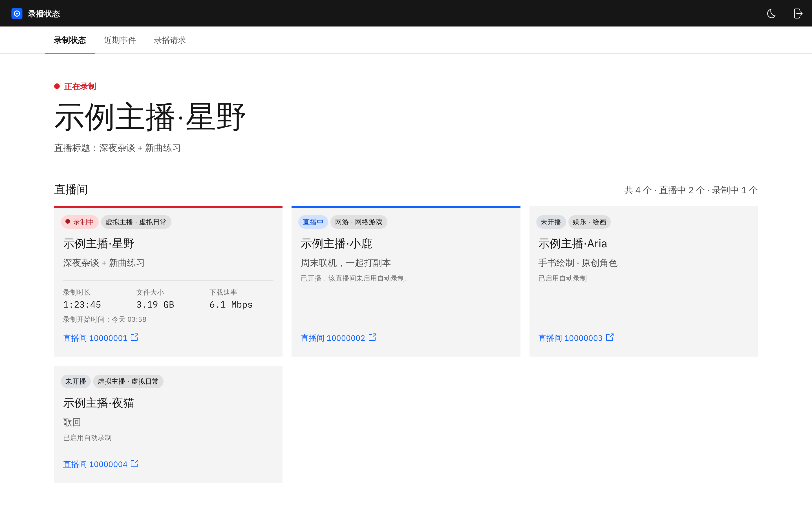
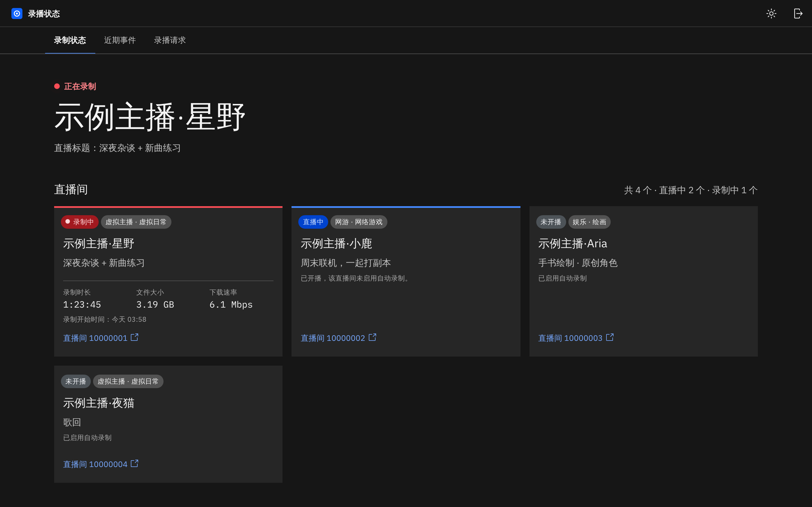
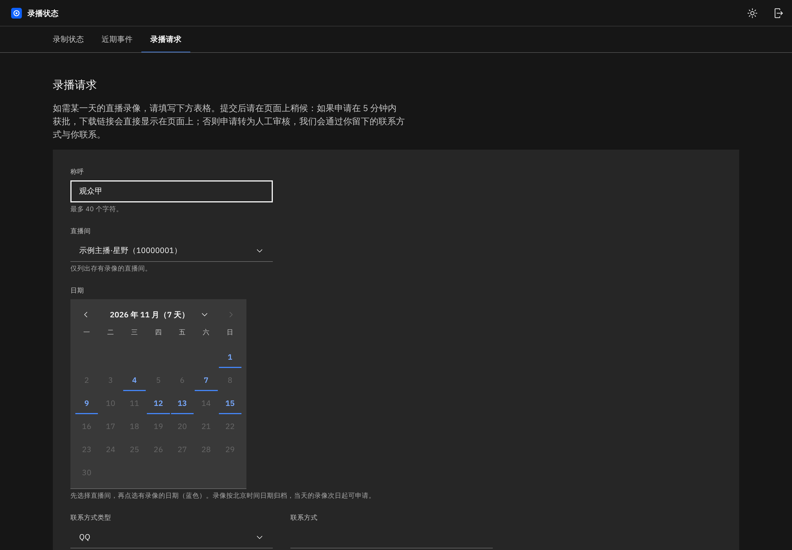
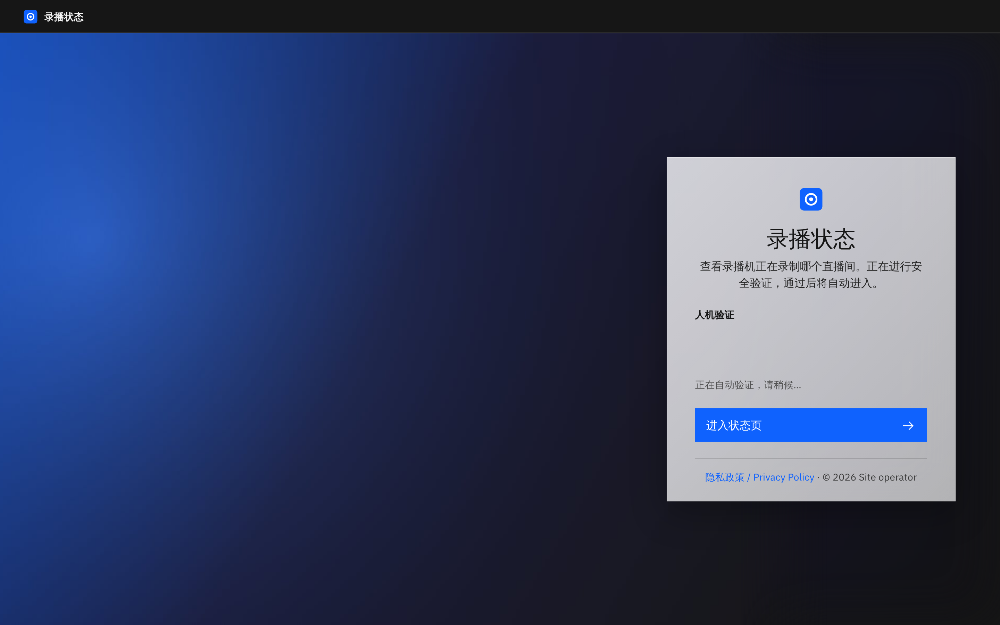
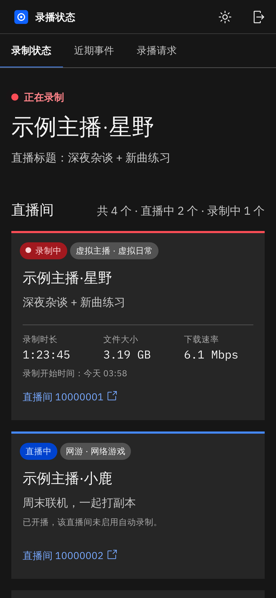

<p align="center"></p>

<h1 align="center">rec-status</h1>

<p align="center"><b>English</b> · <a href="README.zh-CN.md">简体中文</a></p>

A small, self-hosted setup around a live-stream recorder ([BililiveRecorder](https://github.com/BililiveRecorder/BililiveRecorder),
a.k.a. 录播姬) and a file server ([OpenList](https://github.com/OpenListTeam/OpenList)).
When a streamer goes live, the recorder saves the stream; this repo adds a status page,
a way for viewers to request recordings, and a sign-in gate in front of everything.

## Components

| Component | What it does |
|---|---|
| **Status site** | A public page showing which rooms are live and being recorded, plus recent events. Visitors can request a recording through a form. Bilingual (zh/en) privacy policy and cookie notice, written for GDPR and PIPL. |
| **Request flow** | The admin gets an email with signed approve/deny links. The visitor waits on the page for up to 5 minutes. If the request is approved in that time, the page shows the share link the worker created in OpenList. Otherwise the page says the request will be reviewed manually. |
| **Edge gate** | OpenResty/Lua [Cloudflare Turnstile](https://developers.cloudflare.com/turnstile/) checks in front of the OpenList sign-in, OpenList share links and the recorder WebUI. It also includes an IBM Carbon sign-in page and theme for the recorder. |
| **Agent and worker** | Run on the recorder host. The agent pushes recorder state to the status site; the worker handles approved requests (copies files, creates the share, sends mail). Recordings are archived to whatever storage you mount in OpenList (`ARCHIVE_ROOT`): a cloud drive, S3, WebDAV, a NAS and so on. |

All pages use [IBM Carbon](https://carbondesignsystem.com/) styling and IBM Plex fonts.

## Preview

The pages are in Chinese; the screenshots use made-up demo data.

| Status page (light) | Status page (dark) |
|---|---|
|  |  |
| **Recording request form** | **Sign-in (Turnstile)** |
|  |  |

<p align="center"></p>

## Layout

```
status-site/          status site (OpenResty + Lua), served from /www/sites/live in the container
  index/              static pages: index.html (status + request form), privacy.html, assets/
  gate/               Lua: sign-in gate, ingest, status API, requests, review links, store
  proxy/ server/      nginx location and server blocks
  conf.d/             http-level shared dicts
agent/                runs on the recorder host
  rec-status-agent.py     pushes recorder state to the status site (HMAC-signed)
  rec-request-worker.py   pulls approved requests, copies files, creates OpenList shares, sends mail
  *.service, *.env.example
edge-gate/            Turnstile gate for the file server and recorder sites (OpenResty + Lua)
  sites/              nginx snippets to include in each site
  templates/ public/  sign-in / share check pages and assets
  tools/rec-theme-check/  checks that the recorder theme still fits after a recorder upgrade
ops/                  Cloudflare-only origin firewall (nftables), systemd units, logrotate
tools/                build-carbon-css.py (trims Carbon's compiled CSS)
docs/                 repo logo and README screenshots
```

Each component has its own notes:
- `status-site/gate/README` ([中文](status-site/gate/README.zh-CN))
- `edge-gate/README` ([中文](edge-gate/README.zh-CN))

## Request flow

```
  visitor ──Turnstile──▶ status page ──form──▶ /api/request
                                                   │
  recorder host: rec-request-worker ◀──/__agent/sync┘
        │  emails admin: [批准 approve] [拒绝 deny]  (signed links, valid 7 days)
        ▼
  admin approves ──▶ worker copies the day folder to archive storage ──▶ OpenList share (code, expiry, access limit)
        │
        ▼
  visitor's page (waits up to 5 min) shows the link ── otherwise: "reviewed manually"
```

## Setup

1. **Status site.** Copy `status-site/` into an OpenResty site directory and include
   `proxy/live.conf` and `conf.d/00-live.conf`. Create the root-only key files under `gate/`
   with random hex values: `cookie_key`, `ingest_key`, `admin_key` (signs the review links), and
   optionally `edge_key`. Set `public_url` and the captcha values in `gate/live_config.lua`.
2. **Edge gate.** Copy `edge-gate/` to `/www/common/turnstile` and include `sites/*.conf` in
   the matching sites. Store the Turnstile secret with `set-secret.sh` and create `cookie_key`
   and `rs_key` (`rs_key` must equal the status site's `ingest_key`).
3. **Agent and worker.** Copy `agent/*.env.example` to `/etc/rec-status/*.env` (mode 0640),
   fill them in, and install the systemd units.
4. Replace every placeholder:

| Placeholder | Meaning |
|---|---|
| `example.com` | your domain (`rec-status.`, `file.`, `rec.` subdomains) |
| `admin@example.com` | contact / admin mailbox |
| `YOUR_TURNSTILE_SITEKEY` | Cloudflare Turnstile sitekey |
| `203.0.113.10`, `198.51.100.20` | recorder host and status-site origin IPs |
| `esa-xxxxxxxxxx`, `SCENE_ID`, `<rule-id>` | captcha values from the CDN edge (optional; Turnstile is used now) |
| `1Panel-openresty-XXXX` | name of your OpenResty container |

> [!IMPORTANT]
> Secrets are never kept in the repository. Every key file is created on the server, owned by
> root with mode 600; see `.gitignore`.

> [!NOTE]
> The privacy policy (`status-site/index/privacy.html`) is a template. Before you use it, have
> it reviewed for your own processing, providers and jurisdiction.

## Third-party assets

- IBM Plex fonts: SIL Open Font License (`assets/fonts/IBM-Plex-OFL.txt`).
- `carbon.css`: trimmed from `@carbon/styles` (Apache-2.0).
- The background images and logo are placeholders.

## License

[Apache License 2.0](LICENSE). See [NOTICE](NOTICE) for the bundled third-party material.

## Acknowledgements

This project is built around [BililiveRecorder](https://github.com/BililiveRecorder/BililiveRecorder)
(录播姬), which does the actual recording; rec-status only reads its REST API and webhooks and
re-themes its WebUI from the outside. Many thanks to the BililiveRecorder developers and
contributors. rec-status is an independent project and is not affiliated with or endorsed by them.
