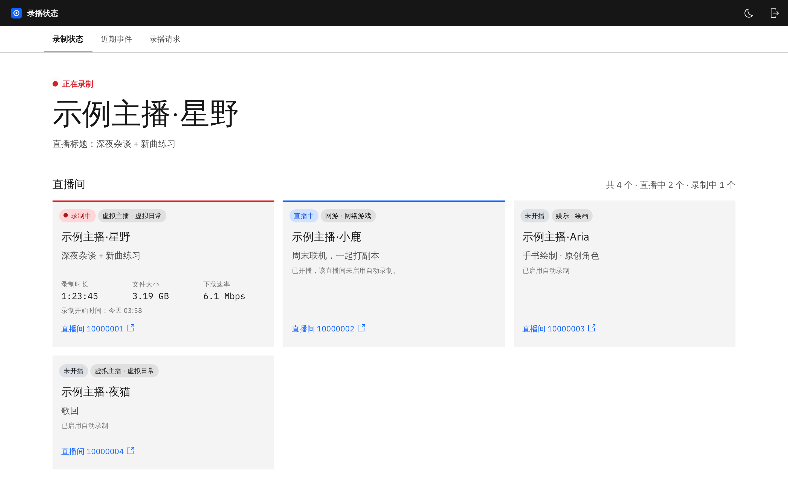
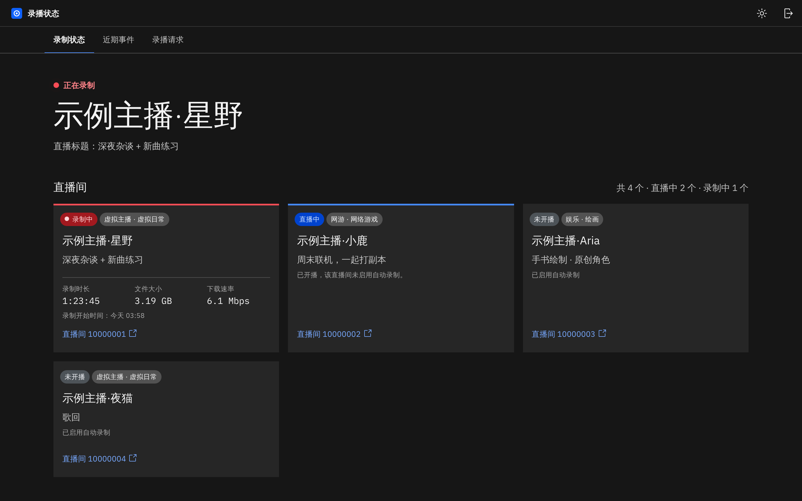
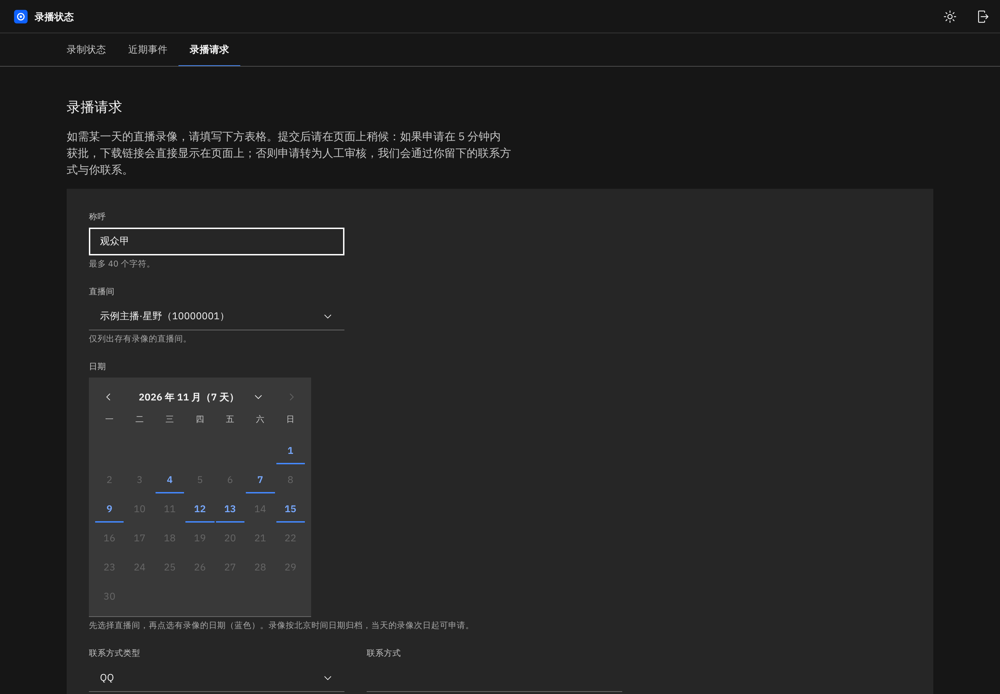
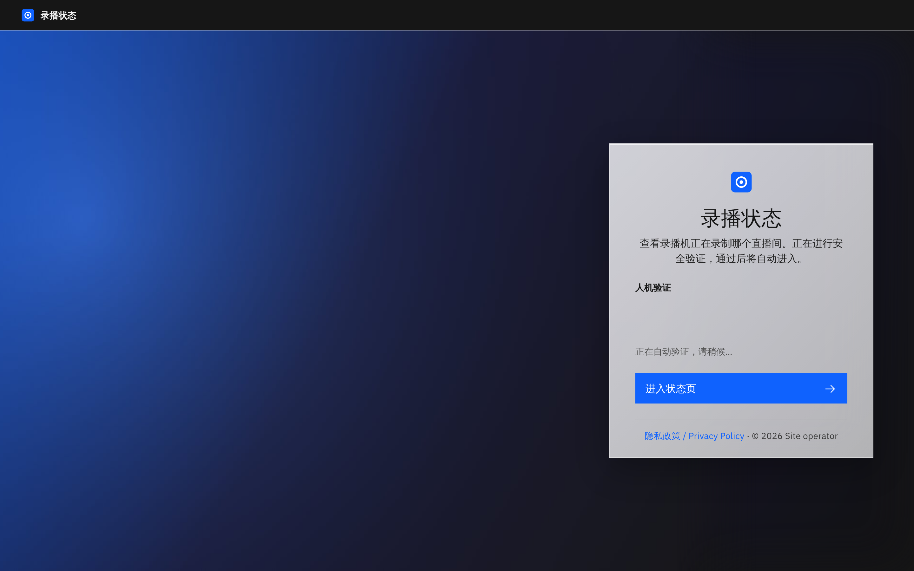
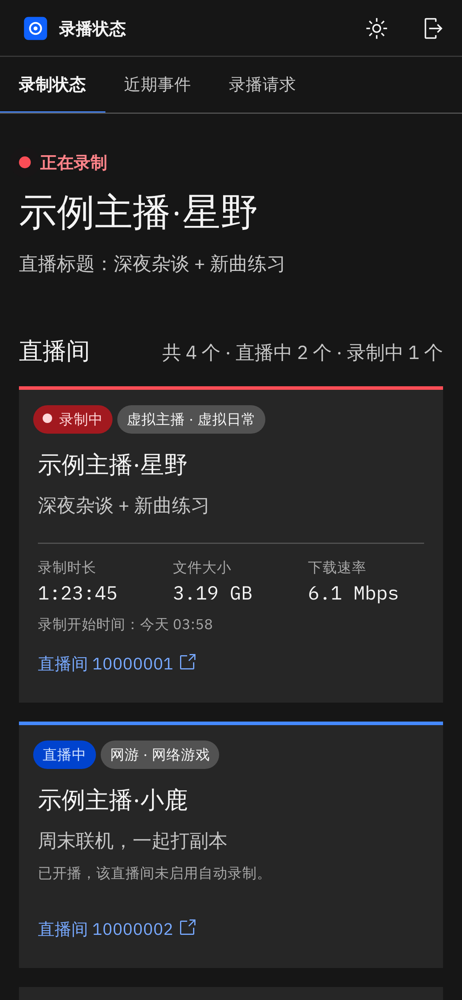

<p align="center"></p>

<h1 align="center">rec-status</h1>

<p align="center"><a href="README.md">English</a> · <b>简体中文</b></p>

一套小巧的自建方案，围绕直播录制工具录播姬（[BililiveRecorder](https://github.com/BililiveRecorder/BililiveRecorder)）
和文件服务器 [OpenList](https://github.com/OpenListTeam/OpenList) 搭建。
主播开播时录播姬负责录制；本仓库在此基础上提供状态页、观众申请录播的流程，以及挡在所有入口前的登录校验。

## 组成部分

| 组件 | 作用 |
|---|---|
| **状态站** | 公开页面，显示哪些直播间正在直播 / 录制，以及最近的事件；访客可以通过表单申请录播。附带中英双语隐私政策和 Cookie 提示，按 GDPR 和 PIPL 编写。 |
| **申请流程** | 管理员收到一封带签名「批准 / 拒绝」链接的邮件。访客在页面上最多等待 5 分钟：期间申请获批，页面就会显示 worker 在 OpenList 里创建的分享链接；否则提示将转人工审核。 |
| **边缘网关** | 基于 OpenResty/Lua 的 [Cloudflare Turnstile](https://developers.cloudflare.com/turnstile/) 校验，位于 OpenList 登录、OpenList 分享链接和录播姬 WebUI 之前。还包含 IBM Carbon 风格的登录页和录播姬主题。 |
| **Agent 和 worker** | 运行在录播机上。agent 把录播姬状态推送到状态站；worker 处理已批准的申请（复制文件、创建分享、发邮件）。录像存档到你在 OpenList 中挂载的任意存储（`ARCHIVE_ROOT`）：网盘、S3、WebDAV、NAS 等均可。 |

所有页面使用 [IBM Carbon](https://carbondesignsystem.com/) 样式和 IBM Plex 字体。

## 预览

截图使用虚构的演示数据。

| 状态页（浅色） | 状态页（深色） |
|---|---|
|  |  |
| **录播申请表单** | **登录（Turnstile）** |
|  |  |

<p align="center"></p>

## 目录结构

```
status-site/          状态站（OpenResty + Lua），容器内路径 /www/sites/live
  index/              静态页面：index.html（状态 + 申请表单）、privacy.html、terms.html、assets/
  gate/               Lua：登录校验、数据接收、状态 API、申请、审核链接、存储
  proxy/ server/      nginx 的 location 与 server 块
  conf.d/             http 级共享字典
agent/                运行在录播机上
  rec-status-agent.py     把录播姬状态推送到状态站（HMAC 签名）
  rec-request-worker.py   拉取已批准的申请、复制文件、创建 OpenList 分享、发邮件
  *.service、*.env.example
edge-gate/            文件服务器和录播站的 Turnstile 网关（OpenResty + Lua）
  sites/              各站点要 include 的 nginx 片段
  templates/ public/  登录 / 分享校验页面及静态资源
  tools/rec-theme-check/  录播姬升级后检查主题是否仍然适配
ops/                  仅限 Cloudflare 的源站防火墙（nftables）、systemd 单元、logrotate
tools/                build-carbon-css.py（裁剪 Carbon 编译后的 CSS）
docs/                 仓库标志和 README 截图
```

各组件的详细说明：
- `status-site/gate/README.zh-CN`（[English](status-site/gate/README)）
- `edge-gate/README.zh-CN`（[English](edge-gate/README)）

## 申请流程

```
  访客 ──Turnstile──▶ 状态页 ──表单──▶ /api/request
                                           │
  录播机：rec-request-worker ◀──/__agent/sync┘
        │  给管理员发邮件：[批准] [拒绝]（签名链接，7 天有效）
        ▼
  管理员批准 ──▶ worker 把当天的文件夹复制到存档存储 ──▶ OpenList 分享（提取码、有效期、访问次数上限）
        │
        ▼
  访客页面（最多等待 5 分钟）显示链接 ── 否则提示「转人工审核」
```

## 部署

1. **状态站。** 把 `status-site/` 复制到 OpenResty 的站点目录，include `proxy/live.conf` 和
   `conf.d/00-live.conf`。然后在 `gate/` 下创建仅 root 可读的密钥文件，内容为随机 hex：
   `cookie_key`、`ingest_key`、`admin_key`（给审核链接签名），以及可选的 `edge_key`。
   在 `gate/live_config.lua` 里设置 `public_url` 和验证码相关参数。
2. **边缘网关。** 把 `edge-gate/` 复制到 `/www/common/turnstile`，在对应站点里 include
   `sites/*.conf`。用 `set-secret.sh` 写入 Turnstile secret，并创建 `cookie_key` 和 `rs_key`
   （`rs_key` 必须与状态站的 `ingest_key` 相同）。
3. **Agent 和 worker。** 把 `agent/*.env.example` 复制为 `/etc/rec-status/*.env`（权限 0640），
   填好内容，安装 systemd 单元。
4. 替换所有占位符：

| 占位符 | 含义 |
|---|---|
| `example.com` | 你的域名（`rec-status.`、`file.`、`rec.` 子域名） |
| `admin@example.com` | 联系 / 管理员邮箱 |
| `YOUR_TURNSTILE_SITEKEY` | Cloudflare Turnstile 的 sitekey |
| `203.0.113.10`、`198.51.100.20` | 录播机和状态站源站的 IP |
| `esa-xxxxxxxxxx`、`SCENE_ID`、`<rule-id>` | CDN 边缘的验证码参数（可选；现已改用 Turnstile） |
| `1Panel-openresty-XXXX` | 你的 OpenResty 容器名 |

> [!IMPORTANT]
> 密钥永远不放进仓库。所有密钥文件都在服务器上创建，属主 root，权限 600，见 `.gitignore`。

> [!NOTE]
> 隐私政策和服务条款（`status-site/index/privacy.html`、`terms.html`）只是模板。使用前请按你自己的数据处理方式、服务商和适用法律请人审阅。

## 第三方资源

- IBM Plex 字体：SIL Open Font License（`assets/fonts/IBM-Plex-OFL.txt`）。
- `carbon.css`：裁剪自 `@carbon/styles`（Apache-2.0）。
- 背景图和 Logo 均为占位图。

## 致谢

本项目围绕 [录播姬（BililiveRecorder）](https://github.com/BililiveRecorder/BililiveRecorder) 搭建，
真正的录制工作都由录播姬完成；rec-status 只读取它的 REST API 和 Webhook，并在外部为它的 WebUI 换上主题。
衷心感谢录播姬的开发者和所有贡献者。rec-status 是独立项目，与录播姬项目没有关联，也未获其背书。
